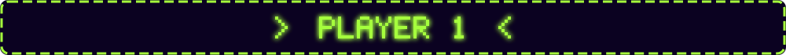
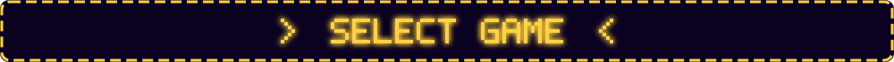
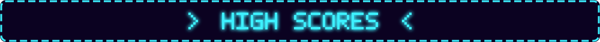

  

  

  

  

<!-- CARTRIDGES:START -->
<!-- CARTRIDGES:END -->

🕹️ Blow on a cartridge to load it: each one opens my repos in that language.

  

  

  

  

<!-- Art is generated by scripts/build_arcade.py from stats fetched by scripts/fetch_stats.py (see .github/workflows/arcade.yml). Edit the CONFIG section in build_arcade.py to change text or games. -->
